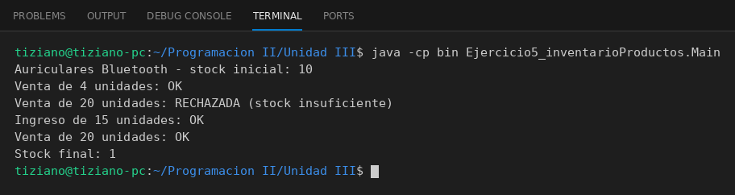

# Producto

Programación II - Unidad 3 - Ejercicio 5

## Consigna
Modelar la clase aplicando encapsulamiento: atributos privados y métodos públicos que validan antes de modificar el estado. Un producto con stock que nunca puede quedar negativo.

## Lógica
- Atributos privados `codigo`, `nombre`, `precio` y `stock`.
- `registrarIngresoStock(cantidad)` suma si la cantidad es positiva.
- `registrarVenta(cantidad)` rechaza la venta si la cantidad supera el stock.
- El stock solo se puede leer con `getStock()`.

## Ejecución

